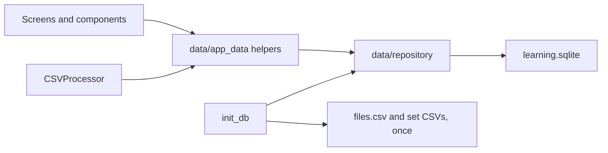
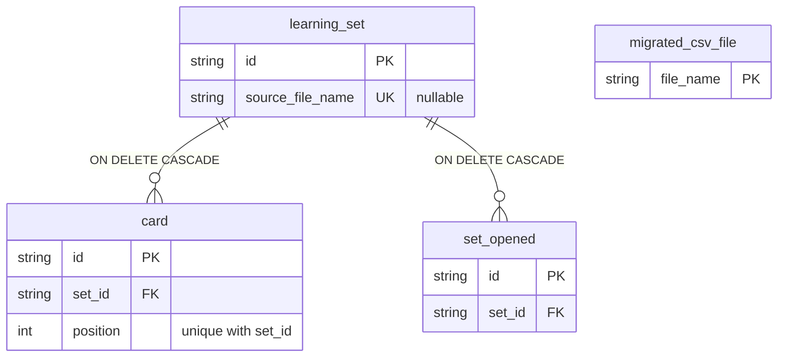
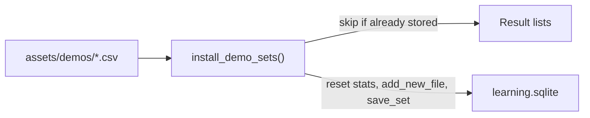

# Data and storage

Learning sets, card progress, visits, and per-set overrides live in a local
SQLite file. Screens still address a set by a `*_words.csv` or
`*_definitions.csv` basename. CSV remains the import, export, and demo-template
format, and the source of a one-time copy at startup. The UI routing layer
does not own this data.

Do not put set content, row statistics, visit rows, or overrides in
`AppSession` or `BodyRegistry`. Those modules hold UI runtime objects only.
See [State and persistence](../guides/state-and-persistence.md).

There is no user column and no server in this schema. Tables are created with
`SQLModel.metadata.create_all`. There is no Alembic migration.

## Storage layout

`FilePathManager` in `data/file_path_manager.py` resolves directories from Flet
environment variables. The database file sits **beside** `csv_files/`, not
inside it.

| Path | Source | Contents |
| --- | --- | --- |
| Application data root | `FLET_APP_STORAGE_DATA` | Platform storage for the app |
| Database | `{data}/learning.sqlite` | Live sets, cards, visits, overrides, and the CSV migration list |
| CSV directory | `{data}/csv_files/` | Leftover set files and `files.csv` used by the startup copy |
| TTS cache | `{data}/tts_cache/` | Generated pronunciation MP3s and JSON sidecars |
| Temporary directory | `FLET_APP_STORAGE_TEMP` | Short-lived files when the platform provides it |

Call `FilePathManager.initialize()` and then `init_db()` once at startup
(already done in `app.py`). `initialize()` creates `csv_files/`. `init_db()`
creates the four tables and copies catalogued CSVs that are not yet listed in
`migrated_csv_file`. When `FLET_APP_STORAGE_DATA` is unset, the CSV directory
falls back to the process current working directory and the database file is
`learning.sqlite` in that directory's parent (or in the CSV directory when it
has no parent).

See the [File path manager API](../reference/file_path_manager.md) and the
[Repository API](../reference/repository.md).

## Tables

Models are in `data/models.py`. Primary keys are UUID text. Card and visit
rows use `ON DELETE CASCADE` from `learning_set`. SQLite foreign keys are
turned on for every connection.

| Table | Role |
| --- | --- |
| `learning_set` | One set: kind, title, subtitle, timestamps, override columns, and the basename screens still pass around |
| `card` | One word-formation row or one definition pair, ordered by `position` |
| `set_opened` | One entry into that set's learn screen, plus the grades given during the visit |
| `migrated_csv_file` | Basename of a CSV already copied in. Deleting the set does not delete this row |

`migrated_csv_file` has no foreign key. The open visit id is a process dictionary, not a fifth table.

### `learning_set`

| Column | Meaning |
| --- | --- |
| `id` | UUID primary key |
| `kind` | `words` or `definitions` |
| `title`, `subtitle` | Tile text |
| `created_at` | Creation time, used for newest-first sorting |
| `last_used` | Last open of the learn screen. `NULL` means never |
| `use_count` | Balance copied from the old catalog. Opening the learn screen does **not** increment this column |
| `source_file_name` | Basename (`Animals_words.csv`). Unique. This is how routes, tiles, and helpers find the row. `NULL` only if a row is created with no name |
| eight override columns | See [Per-set settings](#per-set-settings). `NULL` inherits the app setting |

The tile **use count** is `use_count` plus the number of `set_opened` rows.
`record_set_use()` sets `last_used` and inserts one visit. It does not add 1
to the column. Sorting by `SetSortMode.USE_COUNT` uses that combined total.

`get_file_names_and_titles()` returns basenames in `file_name`, not absolute
paths. Sets with no `source_file_name` are omitted from the catalog.

### `card`

Content columns are text. An unused part of speech is `""` in SQLite, never
`NULL`. Columns that belong to the other set kind stay `""`. The in-memory
DataFrame turns those empty content cells back into missing values so learn
and edit UIs still skip them.

| Column | Role |
| --- | --- |
| `position` | Row order. Unique together with `set_id` |
| content | `verb`, `person`, `thing`, `adjective`, `adverb`, `definition`, `word`. Definition cards also have optional `example_sentence` |
| `correct_answers`, `good_answer`, `good_answers_in_a_row`, `word_to_learn` | The four queue statistics. Unchanged by this store |
| `checks` | How many times the card was graded. Bad answers are `checks - correct_answers`. The queue and the progress bar do not read it |

`checks` is not a member of `StatsColumns`, so an older CSV or a demo template
without that column still validates as a file that has statistics.
`CARD_ID_COLUMN` (`card_id`) travels on the DataFrame so a later save can keep
the same card. It is not written to an exported CSV.

A graded Check updates that one card by id. It does not rewrite the whole
frame. Rewriting after `draw_index_group` would store the sorted order as new
positions.

### `set_opened`

A visit starts when the tile opens `/set/learn` (`record_set_use` /
`open_visit`). Edit and Home do not create one. Further
`/set/learn/session` views in the same visit add to the **same** row, because
the learn route stays on the stack. The open visit id is remembered in the
process. The router drops it when `/set/learn` leaves the stack
(`retain_open_visits`).

Each graded Check increments `checks` on the card and, when a visit is open,
on that visit. A correct Check also increments the visit's
`correct_answers`. Try again, Next, and a draw without Check do not write.
`set_default_progress` zeros card statistics, including `checks`, and leaves
visit rows alone. Old `use_count` values are not turned into visit rows.

Killing the app keeps counters that were already flushed. The next open is a
new visit.

### `migrated_csv_file`

`file_name` is the primary key. It is written in the same transaction as the
copied set. Import, export, and demo install do not fill this table. A deleted
set therefore does not come back from a leftover CSV on the next start.
`delate_set` still deletes that one set's CSV when the file is present, unless
`file_not_exist` is set. Startup does not bulk-delete `csv_files/`.

## Per-set settings {#per-set-settings}

Eight nullable columns on `learning_set` store one set's learning and speech
choices. `NULL` inherits the matching app setting. A stored value is that
set's own choice, including `false`. Columns that belong to the other set kind
stay `NULL` and are ignored. `uses_app_defaults` is derived, not stored.

| Column | Applies to | `NULL` uses |
| --- | --- | --- |
| `tts_language` | both kinds | `TtsPreferences.language` |
| `tts_auto_speak` | `definitions` | `TtsPreferences.auto_speak_definitions` |
| `speakers_word_formations` | `words` | `TtsPreferences.speakers_word_formations` |
| `speakers_word` | `definitions` | `TtsPreferences.speakers_word` |
| `speakers_definition` | `definitions` | `TtsPreferences.speakers_definition` |
| `retry_until_correct` | both kinds | `LearnPreferences.retry_until_correct` |
| `queue_size` | both kinds | the queue size for that kind on `LearnPreferences` |
| `example_mode` | `definitions` | `LearnPreferences.example_mode` |

`data/set_settings.py` (`effective_set_settings`) fills the blanks.
`read_override_cells` still returns `""` for `NULL` and `"true"` / `"false"` /
text / an integer as text, so callers keep the old cell-shaped API.
`add_new_file` and demo install leave all eight columns `NULL`. Home **Set
settings** and the learn-menu settings button open `/set/settings`, where
**Use app settings** writes the current app values or clears the columns
again. `set_default_progress` does not touch them. Settings **Restore
defaults** resets the app preferences only.

A queue value is clamped when read (word formations 3–10, default 5;
definitions 4–15, default 10). Text that is not a whole number falls back to
the app size. An unknown language code becomes English on read. Bool text is
`true`, `1`, `on`, or `yes` for on; any other non-empty text is off. The
database stores the bool and the integer, not those strings. A language is
stored as written. `example_mode` is `off`, `after_check`, or `hint`; other
text is stored as `NULL`. A database created before this column gets it from
one `ALTER TABLE` in `ensure_db`. Changing the language, enabling overrides, or clearing them
runs TTS garbage collection. A Check does not.

See the [Set settings API](../reference/set_settings.md).

## Startup copy from CSV

The first `ensure_db` / `init_db` for a database file reads `files.csv` with
the existing catalog readers (`persist=False`, so missing override columns are
filled in memory only). Each catalog row whose basename is not already in
`migrated_csv_file` is copied in its own transaction:

- A missing set file is skipped. A file that cannot be read is skipped. The
  app does not crash.
- New UUIDs. `position` follows CSV row order.
- Content for the other kind is `""`.
- `card.checks` is set to that card's `correct_answers` (not 0).
- No `set_opened` rows are created.
- An empty `last_used` becomes `NULL`. An empty override cell becomes `NULL`.
- A bool cell uses the tokens above. A whole-number `queue_size` is stored
  even outside the slider range; other text becomes `NULL`.
- `tts_language` is the cell text, not a normalized code.
- Override columns for the other kind become `NULL` even when the cell has
  text.
- Current `TtsPreferences` / `LearnPreferences` are not copied onto the set.

A second start does not import those files again and does not overwrite
SQLite progress. CSV files are left on disk. A set that exists only as a CSV
dropped into `csv_files/` without a catalog row is not a set.

`validate_files_csv` and `repair_files_csv` still operate on the leftover
`files.csv`. Home, create, and import no longer block on that file and no
longer delete a database set because its CSV is missing.

## Set CSV shape

Import, export, and the demo templates under `src/assets/demos/` still use
this shape. `get_kind_of_file_and_validate()` enforces the `_words.csv` or
`_definitions.csv` suffix. `sanitize_file_name()` strips non-alphanumeric
characters and appends the kind suffix when creating a basename.

### Words

Content columns (`PartsOfSpeech`): `verb`, `person`, `thing`, `adjective`,
`adverb`.

### Definitions

Content columns (`WordDefinitions`): `definition`, `word`. Optional
`example_sentence` holds an example whose answers sit inside braces
(`Please {turn} the lights {off}.`). A blank cell means the card has no example.
Import accepts a definitions file that omits the column. A non-empty cell
must contain one to four non-nested gaps, with some sentence text outside
the braces. `/` inside one gap is another accepted form of that same gap.

### Statistics

| Column | Role |
| --- | --- |
| `correct_answers` | Integer count of successful answers |
| `good_answer` | Last-answer / known-state flag |
| `good_answers_in_a_row` | Streak flag used by the learning queue |
| `word_to_learn` | Priority flag for the next draw group |
| `checks` | Graded Checks. Optional on an imported file. Not a `StatsColumns` member |

`create_empty_set(kind)` builds an empty DataFrame with the content columns,
the four statistics columns, and `checks`. `load_set` / `save_set` read and
write the database. After load, content columns are strings; empty content is
missing; statistics stay numeric or bool. `save_set` keeps existing card ids,
gives new rows new ids, keeps a stored `checks` count when the frame omits
the column, and starts a new card at 0. Positions are rewritten after a
temporary negative flush so the unique `(set_id, position)` constraint holds.

`MAX_ROWS` in `data/constants.py` caps how many content rows a set may
contain (currently `80`). Import validation enforces that limit.

`set_default_progress(file_name)` resets card statistics, including `checks`,
without removing content or visits. `get_set_learn_progress(file_name)`
returns the weighted Home / learn-menu bar values described in
[Learning algorithm](../concepts/learning-algorithm.md#progress-helpers).
A missing set returns `(0, 0)`.

Export builds CSV bytes from the database (`index=True`), includes `checks`,
and drops `card_id`. Import keeps `checks` when the user keeps statistics and
the column is present. When they keep statistics and the column is absent,
`checks` is copied from `correct_answers`. A reset, or a file without usable
statistics, stores `checks` as 0. `checks` is not an unnecessary extra column.

Catalog and set CSV readers still treat only blank cells as missing
(`read_catalog_csv` / `read_set_csv` with `keep_default_na=False`). Titles or
words that look like pandas NA sentinels (`None`, `null`, `NA`, `nan`) stay
as written.

See the [Constants API](../reference/constants.md) and
[App data API](../reference/app_data.md).

## TTS cache {#tts-cache}

Pronunciation MP3s live under `tts_cache/<hash[:2]>/<hash>.mp3` plus a JSON
sidecar (`learning_app/tts/`). Cache keys include provider, voice, language,
and normalized text. Garbage collection keeps a recording while some set still
speaks that phrase in that language. Phrases are read from the database, not
by scanning `csv_files/`. The language is the set's stored `tts_language`, or
the app language when that column is `NULL`. The same spelling in two
languages is two live pairs.

GC runs after `delate_set`, after content saves with `prune_tts=True`, and
after a set language is stored, enabled, or cleared. A Check does not run it.
Empty shard folders may remain after GC.

Playback is session-owned (`AppSession.speak`); screens must not construct
`Audio`. The language and auto-speak used for a set are the effective values
from [Per-set settings](#per-set-settings). App defaults live in preferences —
see [Text to speech](../guides/state-and-persistence.md#text-to-speech).
Signatures are in the [TTS API](../reference/tts.md).

## `AppData` versus catalog helpers

Module-level functions in `data/app_data.py` are the API screens call. They
delegate catalog, load, save, delete, reset, and visits to `data/repository.py`.
The `AppData` class loads one set into a DataFrame for a learning session,
draws word groups from the four statistics columns, and writes the current
card after each graded answer.

Use the helpers when listing, creating, deleting, or editing sets. Use
`AppData` when running a learn session. Queue and answer rules are documented
in [Learning algorithm](../concepts/learning-algorithm.md).

## Import path (overview)

`CSVProcessor` in `data/csv_processor.py` validates an imported CSV and saves
it into the database with or without keeping statistics. It can still validate
and repair a leftover `files.csv`; those helpers are not on the Home, create,
or import path. The task flow is in the
[Import and export guide](../guides/import-export.md).

## Demo sets

Bundled sample CSVs live under `src/assets/demos/` (read-only templates, no
override columns and no `checks` column). They are not copied into
`csv_files/`. Settings calls `install_demo_sets()` in `data/demo_sets.py`,
which reads each missing template, resets statistics (`checks` becomes 0),
and registers a database row with a **fixed** basename (for example
`DemoWordFormation_words.csv`) and eight `NULL` overrides. Every card in the
two definitions demos has an example sentence.

Resolution uses `FLET_ASSETS_DIR` after `flet build`, with a local fallback to
`src/assets`. Create and import must not claim those basenames:
`allocate_unique_set_basename()` treats `RESERVED_DEMO_SET_NAMES` as occupied
even when a demo is not installed yet, so a user set gets a numbered variant
instead. Installation itself uses `is_demo_already_installed()` (stored set
only), so Add can recreate a demo after the user deletes it.

After a successful install, Settings refreshes Home and export tile lists
through `BodyRegistry` when those bodies exist.

See the [Demo sets API](../reference/demo_sets.md).

## Module map

| Module | Responsibility |
| --- | --- |
| `data/file_path_manager.py` | Storage roots, `learning.sqlite`, CSV paths, and `tts_cache/` |
| `data/models.py` | `LearningSet`, `Card`, `SetOpened`, `MigratedCsvFile` |
| `data/repository.py` | Engine, sessions, CRUD, visits, export bytes, startup CSV copy |
| `data/constants.py` | Schema enums, `checks` / `card_id` names, `MAX_ROWS`, import messages |
| `data/app_data.py` | Public catalog and load/save API, empty sets, `AppData` |
| `data/set_settings.py` | Effective overrides and writes onto `learning_set` |
| `data/csv_processor.py` | Import validation and save into the database; leftover `files.csv` repair |
| `data/demo_sets.py` | Bundled demo registry, reserved names, install into the database |
| `tts/` | Pronunciation cache, gTTS provider, and GC from database phrases |

## Continue reading

- [Architecture overview](index.md)
- [Learning algorithm](../concepts/learning-algorithm.md)
- [Import and export](../guides/import-export.md)
- [State and persistence](../guides/state-and-persistence.md)
- [Models API](../reference/models.md)
- [Repository API](../reference/repository.md)
- [File path manager API](../reference/file_path_manager.md)
- [App data API](../reference/app_data.md)
- [Constants API](../reference/constants.md)
- [CSV processor API](../reference/csv_processor.md)
- [Demo sets API](../reference/demo_sets.md)
- [TTS API](../reference/tts.md)
