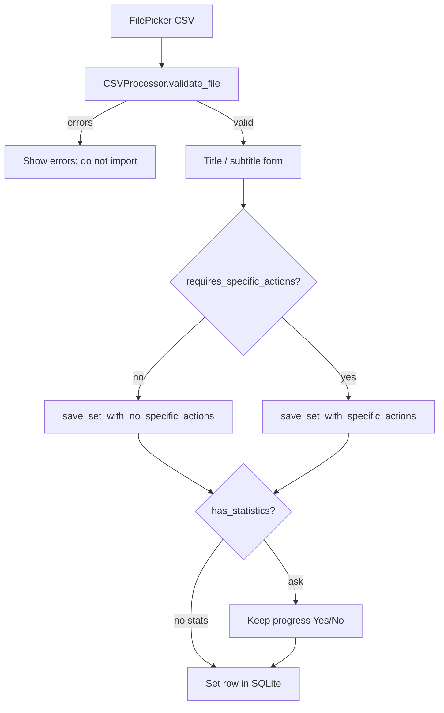

# Import and export

Import adds an external CSV as a new learning set. Export copies an existing
set out through the shared file picker. Validation and repair live in
`data/csv_processor.py`; the Import/Export screen in
`ui/screens/import_export_control.py` drives the dialogs.

Set schemas and storage paths are described in
[Data and storage](../architecture/data-and-storage.md). Message enums are in
the [Constants API](../reference/constants.md).

## Import flow



`ImportExportControl` picks a single `.csv` file with its **own**
`FilePicker` (`csv_file_selector` on the screen) using `with_data=True` so the
file contents are available even when `path` is `None`. In that case the
control materializes `file.bytes` into a temporary file before calling
`validate_file`. It then shows warnings or errors with `create_alert_dialog`
from `ui/page_functions.py` (title + message, optional second action button for
Yes/No flows such as keep-progress). On success it stores validation flags on
the control and lets the user confirm title and subtitle before save. There is
no separate API page for that helper — call it from screen code when you need
a blocking alert over Import/Export (or reuse the same pattern elsewhere).

Export is separate: tile actions use
`AppSession.get_export_csv_picker()` (see
[State and persistence](state-and-persistence.md)). That shared picker is a
runtime service for **export only**, not for choosing an import file and not a
place to hold CSV content.

## Validate a set file

```python
from learning_app.data.csv_processor import CSVProcessor

result = CSVProcessor.validate_file(file_path, original_name=picked_file_name)
```

Pass `original_name` (picker display name / basename) when the path may be a
temporary file (web/mobile). Suffix checks and `name_suggestion` use that
name, not the temp path.

`validate_file` returns a dict:

| Key | Meaning |
| --- | --- |
| `is_valid` | `False` when import must stop |
| `errors` | Fatal messages (`Errors` enum values) |
| `warnings` | Non-fatal messages (`Warnings` enum values) |
| `requires_specific_actions` | `True` when save must use the repair path |
| `has_statistics` | `True` when all stats columns look usable |
| `data_type` | `"words"` or `"definitions"` when detected |
| `name_suggestion` | Title stem only when the original name ends in `_words.csv` or `_definitions.csv`; otherwise empty |

### Errors versus warnings

- **Errors** block import (`is_valid` becomes `False`): not a CSV, load
  failure, missing required content columns, too many rows (`MAX_ROWS`),
  empty content that cannot form a set, and similar hard failures.
- **Warnings** allow import to continue but set
  `requires_specific_actions`: bad index column, unexpected extra columns,
  broken or inconsistent statistics, sparse rows that should be dropped on
  save, and related issues.
- Missing `_words.csv` / `_definitions.csv` on the original name also sets
  `requires_specific_actions` so save can allocate a correct basename, but
  that is not surfaced as a user-facing warning.

When `is_valid` is `False`, the UI shows the error list and does not open the
title form. When valid with warnings, the UI still proceeds and surfaces the
warning text.

## Save after validation

Choose the save helper from the validation flags:

| Condition | Helper |
| --- | --- |
| Valid, no specific actions | `save_set_with_no_specific_actions` |
| Valid, specific actions required | `save_set_with_specific_actions` |

Both helpers:

1. Read the picked file.
2. Normalize or rebuild statistics columns according to `has_statistics` and
   `keep_statistics`.
3. Rebuild a contiguous index from zero.
4. Allocate a unique basename via `allocate_unique_set_basename()` from
   `data/demo_sets.py` (also used when creating a set). Stored sets and
   **reserved demo basenames** count as taken, so import/create cannot claim
   a demo slot.
5. Call `add_new_file` and `save_set`, which write the database. When
   statistics are kept and the file has a `checks` column, that count is
   kept. When statistics are kept and the column is absent, `checks` is
   copied from `correct_answers`. Otherwise `checks` is 0.

```python
CSVProcessor.save_set_with_no_specific_actions(
    file_path,
    file_name,
    title,
    subtitle,
    has_statistics=True,
    keep_statistics=True,
)
```

```python
info = CSVProcessor.save_set_with_specific_actions(
    file_path,
    file_name,
    title,
    subtitle,
    data_type="words",
    has_statistics=True,
    warnings=result["warnings"],
    keep_statistics=False,
)
```

`save_set_with_specific_actions` may return an information string (for
example when statistics columns were discarded because of type errors). The
Import screen shows that text in a follow-up dialog.

### Keep progress dialog

When `has_statistics` is `True`, the UI asks whether to keep progress. That
maps to `keep_statistics=True` (Yes) or `False` / treating the file as
without usable stats (No). Do not invent a third persistence path in screen
code; pass the flag into the matching save helper.

## Leftover catalog: `files.csv`

The live catalog is the database. Home, create, and import do not read
`files.csv` and do not ask for a restart when that file is invalid. Startup
copies it once; see
[Startup copy from CSV](../architecture/data-and-storage.md#startup-copy-from-csv).

`validate_files_csv` and `repair_files_csv` remain for that leftover file.
Validation checks existence, required columns, empty names/titles, duplicate
basenames, suffix rules, and whether listed files exist on disk. Missing
files are warnings; structural problems are errors. Repair may recover rows
when pandas cannot parse the file, add missing catalog columns or rebuild
from set files on disk, drop bad rows, fill empty subtitle cells when they
are missing, and remove duplicates or missing-file entries. A catalog that
cannot be read as text is left unchanged. A missing catalog is not created
by repair. These helpers do not write SQLite.

## Export

Export tiles reuse the shared export `TilesContainer` from
[Body registry](../concepts/body-registry.md). Choosing export on a tile builds CSV bytes from the database
(`export_set_csv_bytes`: row index, statistics, and `checks`; no `card_id`),
then calls `AppSession.get_export_csv_picker().save_file(..., src_bytes=...)`
so Flet writes or downloads the bytes (required on web and mobile; also used
on desktop). Per-set overrides stay on the set row and are not part of the
export. A `SnackBar` confirms success; failures still use
`create_alert_dialog`. Export does not re-run `validate_file`.

### Search on the Export tab

The Import/Export screen shows the bottom-bar search button only while the
**Export** tab is selected. Clicking it calls `go_search(..., mode="export")`,
which hosts `SearchControl` in the shared AppBar over the export body
(registered when `ImportExportControl` first builds). Do not call export
search before visiting Import/Export — see
[Navigation guide](navigation.md#open-search) and
[Body registry](../concepts/body-registry.md).

## Ownership checklist

| Concern | Owner |
| --- | --- |
| Validate / repair / import save | `CSVProcessor` |
| Unique basename (incl. reserved demos) | `allocate_unique_set_basename` in `demo_sets` |
| Dialogs and form state | `ImportExportControl` (+ `create_alert_dialog`) |
| Import file picker | `ImportExportControl.csv_file_selector` |
| Shared export picker | `AppSession` |
| Database paths and catalog helpers | `FilePathManager` / `app_data` / `repository` |

Do not keep imported DataFrames or catalog rows in `AppSession`.

## Continue reading

- [Data and storage](../architecture/data-and-storage.md)
- [Learning algorithm](../concepts/learning-algorithm.md)
- [State and persistence](state-and-persistence.md)
- [CSV processor API](../reference/csv_processor.md)
- [Demo sets API](../reference/demo_sets.md)
- [Constants API](../reference/constants.md)
- [App session API](../reference/app_session.md)
